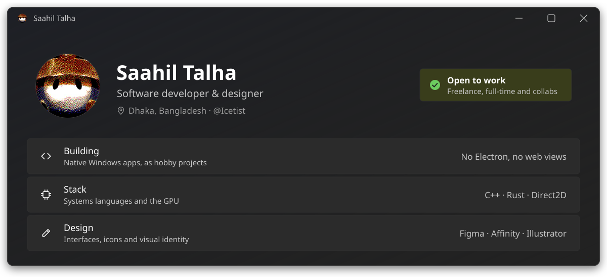
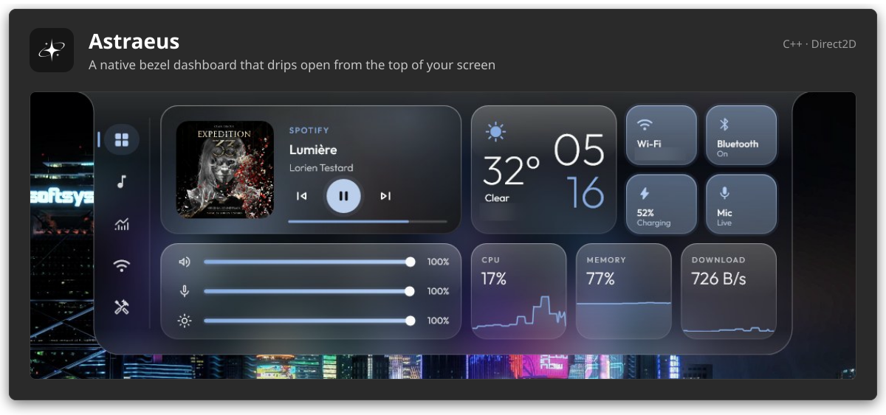
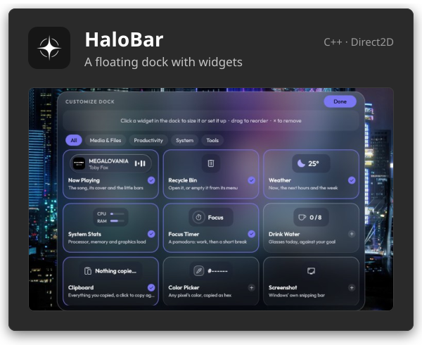
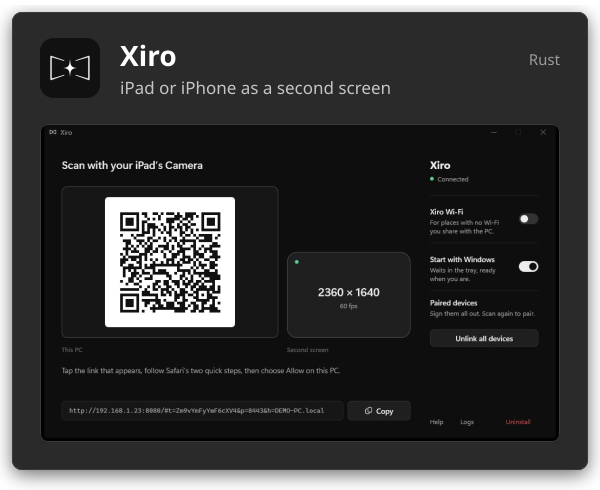
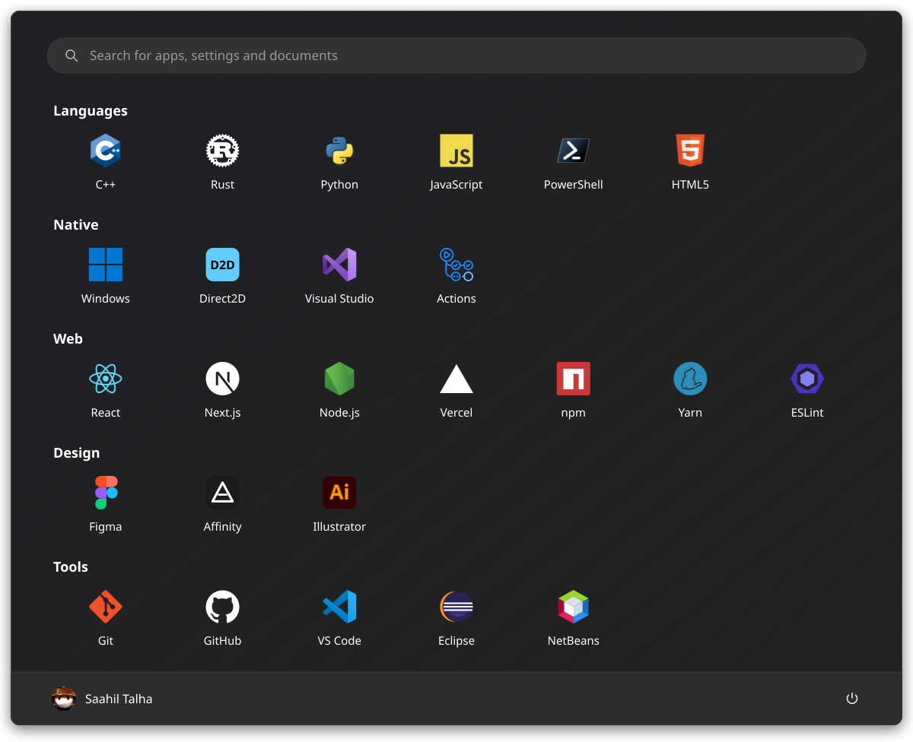
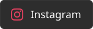
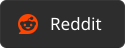
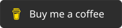

<picture>
  <source media="(prefers-color-scheme: light)" srcset="assets/light/profile.svg" />
  
</picture>

I build native Windows software and design the interfaces that sit on top of it. I like apps
that feel light, fast and quietly considered, so I write them in **C++** and **Rust**, draw them
with **Direct2D**, and design them first in **Figma**, **Affinity** and **Illustrator**.

### Hobby projects

<a href="https://github.com/Icetist/Astraeus">
  <picture>
    <source media="(prefers-color-scheme: light)" srcset="assets/light/astraeus.svg" />
    
  </picture>
</a>

<a href="https://github.com/Icetist/HaloBar"><picture><source media="(prefers-color-scheme: light)" srcset="assets/light/halobar.svg" /></picture></a>
<a href="https://github.com/Icetist/Xiro"><picture><source media="(prefers-color-scheme: light)" srcset="assets/light/xiro.svg" /></picture></a>

### More projects

My other work is pinned at the bottom of this page.

<!-- To list a project here, add a line like:
- [ProjectName](https://github.com/Icetist/ProjectName): short description
-->

### Toolkit

<picture>
  <source media="(prefers-color-scheme: light)" srcset="assets/light/toolkit.svg" />
  
</picture>

### Activity

<picture>
  <source media="(prefers-color-scheme: light)" srcset="https://raw.githubusercontent.com/Icetist/Icetist/output/stats-light.svg" />
  
</picture>

<picture>
  <source media="(prefers-color-scheme: light)" srcset="https://raw.githubusercontent.com/Icetist/Icetist/output/snake-light.svg" />
  
</picture>

### Get in touch

  <a href="mailto:saahil.alam@gmail.com?subject=Let's%20work%20together"><picture><source media="(prefers-color-scheme: light)" srcset="assets/light/btn-mail.svg" /></picture></a>
  <a href="https://www.linkedin.com/in/saahiltalha/"><picture><source media="(prefers-color-scheme: light)" srcset="assets/light/btn-linkedin.svg" /></picture></a>
  <a href="https://www.instagram.com/saahiltalha/"><picture><source media="(prefers-color-scheme: light)" srcset="assets/light/btn-instagram.svg" /></picture></a>
  <a href="https://discordapp.com/users/711824195885072405"><picture><source media="(prefers-color-scheme: light)" srcset="assets/light/btn-discord.svg" /></picture></a>
  <a href="https://www.reddit.com/user/IcetistOfficialz"><picture><source media="(prefers-color-scheme: light)" srcset="assets/light/btn-reddit.svg" /></picture></a>
  <a href="https://www.buymeacoffee.com/icetist"><picture><source media="(prefers-color-scheme: light)" srcset="assets/light/btn-bmc.svg" /></picture></a>

